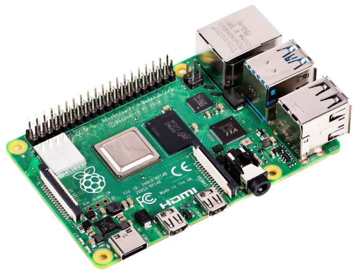
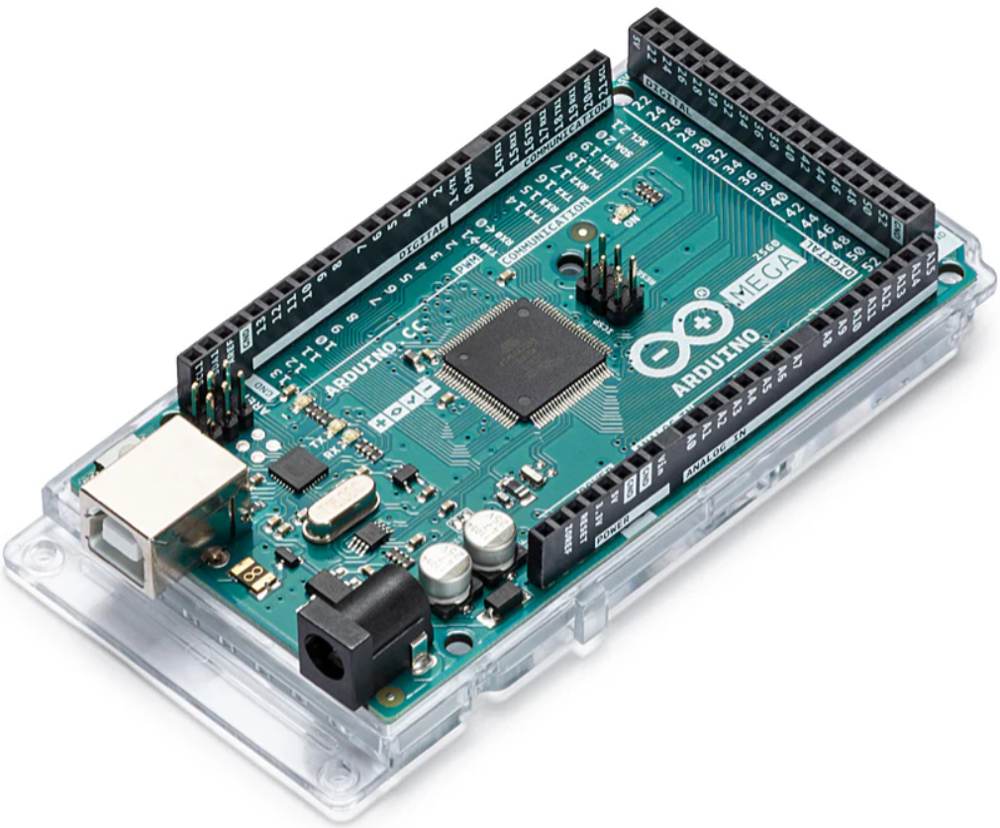
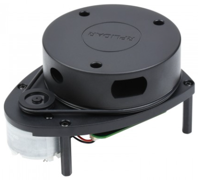
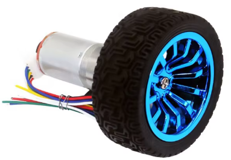
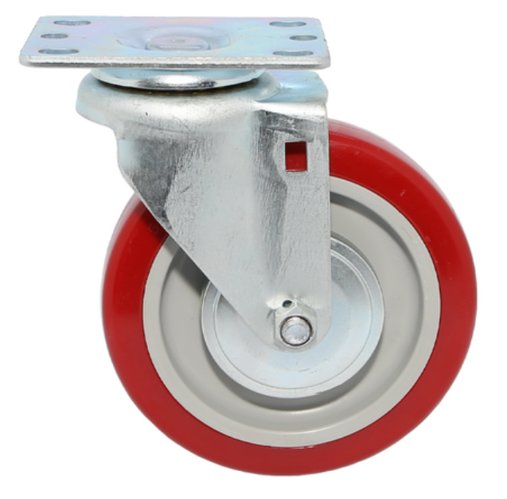
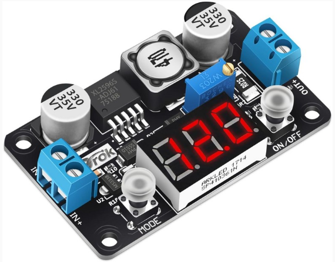
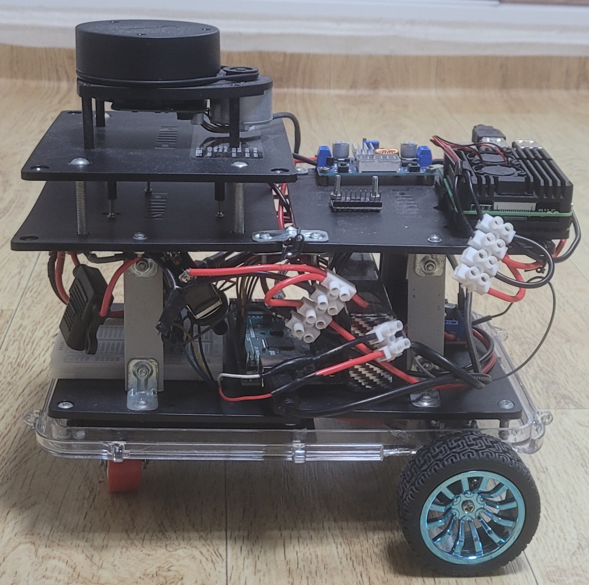
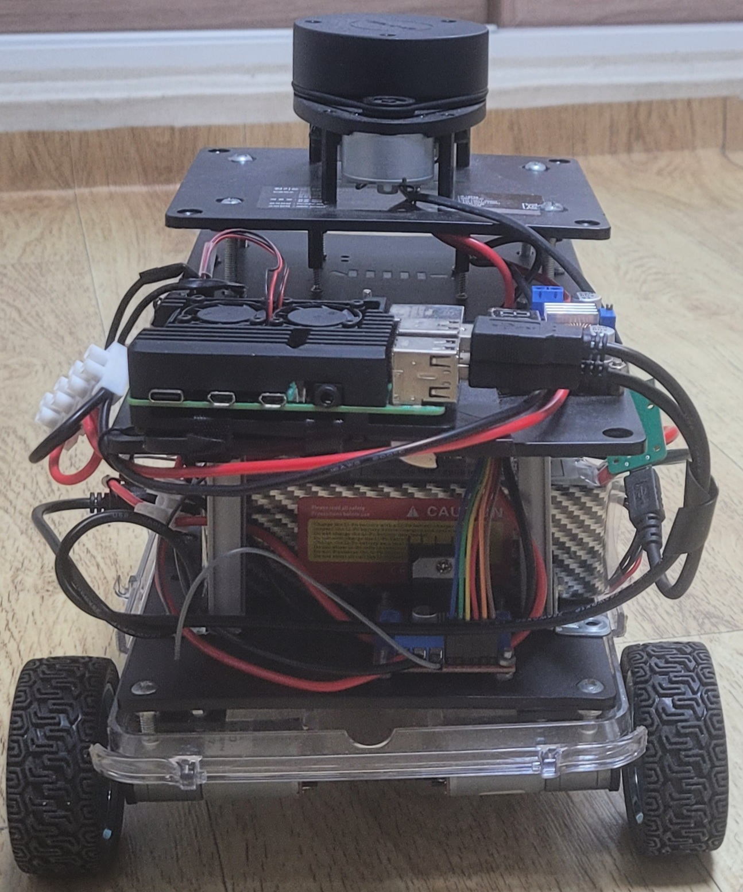
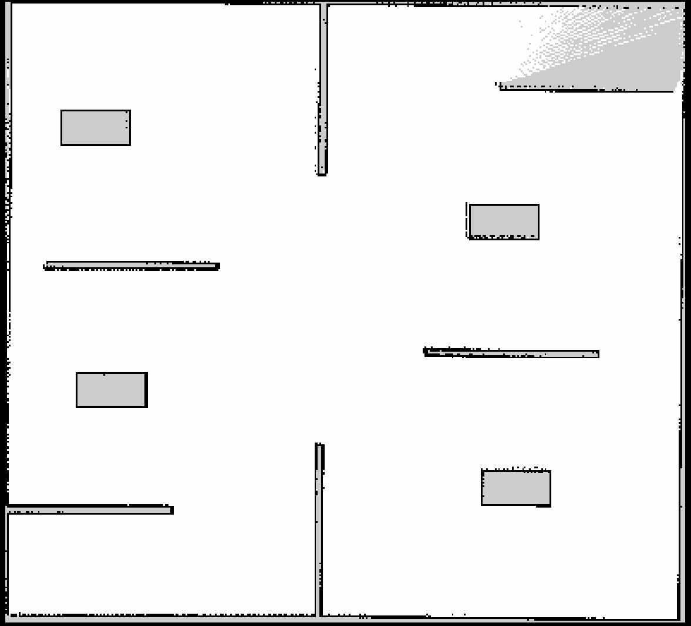
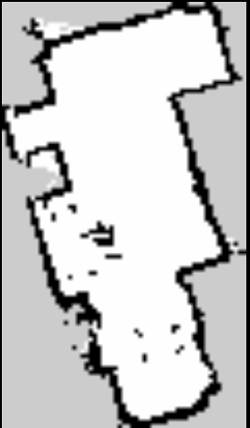

# 2D LiDAR-Based Autonomous Navigation of a Differential Drive Robot

## 📌 Overview

This repository implements autonomous navigation of a differential drive mobile robot using **ROS 2 Humble**. The project leverages a **2D LiDAR (Slamtec RPLIDAR A1)** for simultaneous localization and mapping (SLAM) and **Navigation2 (Nav2)** for path planning, obstacle avoidance, and autonomous navigation. Additionally, it integrates a standard camera and depth camera for visual SLAM and object tracking.
The project is fully validated in both **Gazebo simulation** and on a **real-world hardware platform**. 

---

## Project Features:
- ROS2 Humble-based differential drive robot simulation.
- URDF/Xacro robot description.
- 2D LiDAR integration, IMU, Camera and Depth Camera integration.
- SLAM using SLAM Toolbox.
- Autonomous navigation using Navigation2.
- Obstacle avoidance, and object detection.
- Gazebo Fortress simulation.
- Real robot implementation.
  
---

# Hardware Implementation

## 🛠 Hardware Components

|Roll No.|           Component                |                 Image                                                                   |      Description   |
|--------|------------------------------------|-----------------------------------------------------------------------------------------|--------------------|
|    1   | Raspberry Pi 4                     | | Main onboard computer |
|    2   | Arduino Mega 2560                  |  | Low-level motor controller |
|    3   | 2D LiDAR                           |  | Environment perception |
|    4   | L298N Motor Driver                 | | DC motors controls |
|    5   | DC Geared Motors (with encoders)   | | Two 12V 130rpm geared dc motors |
|    6   | Caster Wheel                       |  | Robot support |
|    7   | 3S LiPo Battery                    | | 5000 mAh 11.1v 3S Lipo battery for powering the robot |
|    8   | DC-DC Buck Converter               | | High-power step-down XL4015 5A 75W variable DC converter 5v supply for electronics |
|    9   | Robot Chassis                      |                                                                                         | - |
|    10   |Gamepad controller                  | | Xbox Microsoft 4th generation wireless controller for remote control |

---

## Differential Drive Robot Hardware Platform

<table>
<tr>
<td align="center">
<b></b><br>


</td>

<td align="center">

<video src="https://github.com/user-attachments/assets/5a1af23a-5dcf-43fd-aae2-492f7fd122ab" width="200" height="200" controls></video>
</td>
</tr>
</table>

---
## Encoder Driver and Motor Driver Modification
This section describes the modification made to `encoder_driver` and `ROSArduinoBridge` sections of the [`ROSArduinoBridge`]( https://github.com/joshnewans/ros_arduino_bridge.git) repository to ensure compatibility  with Arduino Mega 2560. The original repository used Arduino Uno board, so modifications were made to adapt the motor and encoder driver to the Mega 2560.
- Download motor control code from [`ROSArduinoBridge`]( https://github.com/joshnewans/ros_arduino_bridge.git) repository.
- Modify the Interrupt routine encoder reading (`encoder_driver`) of `ROSArduinoBridge`:
  
  I. Interrupt routine for LEFT and RIGHT encoder, taking care of actual counting:
  ```bash
  ISR (PCINT2_vect){
   static uint8_t left_enc_last=0;
   static uint8_t right_enc_last=0;
   uint8_t port_pink = PINK;
  
   // Left motor encoder reading
   left_enc_last <<=2; //shift previous state two places
   left_enc_last |= (port_pink & 0x03); //read the current state
   left_enc_pos += ENC_STATES[(left_enc_last & 0x0f)];

   // Right motor encoder reading
   right_enc_last <<=2; //shift previous state two places
   right_enc_last |= (port_pink & 0x0C) >> 2; //read the current state into lowest 2 bits
   right_enc_pos += ENC_STATES[(right_enc_last & 0x0f)];
  }
  
  ```
  II. Also, Modify the `ROSArduinoBridge` serial communication:
  
  ```bash
  // Initialize the motor controller if 
  #ifdef USE_BASE
  #ifdef ARDUINO_ENC_COUNTER
    //set as inputs
    DDRK &= ~(1<<LEFT_ENC_PIN_A);
    DDRK &= ~(1<<LEFT_ENC_PIN_B);
    DDRK &= ~(1<<RIGHT_ENC_PIN_A);
    DDRK &= ~(1<<RIGHT_ENC_PIN_B);
    
    //enable pull up resistors
    PORTK |= (1<<LEFT_ENC_PIN_A);
    PORTK |= (1<<LEFT_ENC_PIN_B);
    PORTK |= (1<<RIGHT_ENC_PIN_A);
    PORTK |= (1<<RIGHT_ENC_PIN_B);
    
    // pin change mask to listen to left encoder pins
    PCMSK2 |= (1 << LEFT_ENC_PIN_A)|(1 << LEFT_ENC_PIN_B);
    // pin change mask to listen to right encoder pins
    PCMSK2 |= (1 << RIGHT_ENC_PIN_A)|(1 << RIGHT_ENC_PIN_B);
    // enable PCINT1 and PCINT2 interrupt in the general interrupt mask
    PCICR |= (1 << PCIE2);
  #endif
  initMotorController();
  resetPID();
  #endif
  ```
- Port K port register pins (which are pin A8 to A15) of Arduino mega2560 are used for interrupt routine.
- Modify `encoder_driver.h` and `motor_driver.h` sections according to the following wiring diagram: 
  
|           From                                               | To                    |
| ------------------------------------------------------------  | -----------------------|
| Left Motor Positive terminal                                  | OUT2 L298N motor driver|
| Left Motor Encoder negative terminal                          | GND pin Arduino2560    |
| Left Motor Encoder A phase signal feedback                    | pin A8 Arduino mega2560|
| Left Motor Encoder B phase signal feedback                    | Pin A9 Arduino mega2560|
| Left Motor Encoder positive terminal                          | Arduino mega2560 3V     |
| Left Motor negative terminal                                  | OUT1 L298N motor driver|
| Right Motor positive terminal                                 | OUT3 L298N motor driver |
| Right Motor Encoder negative terminal                         |GND pin Arduino2560|
| Right Motor Encoder A phase signal feedback                   | Pin A11 Arduino mega2560|
| Right Motor Encoder B phase signal feedback                   | Pin A10 Arduino mega2560 |
| Right Motor Encoder positive terminal                         | Arduino mega2560 3V|
| Right Motor negative terminal                                 |OUT4 L298N motor driver |
| Left Motor direction (IN1, L298N motor driver)                | Pin D9 Arduino mega2560|
| Left Motor direction (IN2, L298N motor driver)                | Pin D5 Arduino mega2560|
| Left Motor enable   (ENA, L298N motor driver)                 | Pin D12 Arduino mega2560|
| Right Motor direction  (IN3, L298N motor driver)              |Pin D10 Arduino mega2560 |
| Right Motor direction  (IN4, L298N motor driver)              |Pin D6 Arduino mega2560 |
| Right Motor Enable     (ENB, L298N motor driver)              | Pin A13 Arduino mega2560|

- The modified version for this project can be found [`here`]( https://github.com/eyasuder/ros_arduino_bridge)

---
## Motor Experiment
This is to determined the encoder counts per revolution (CPR) of the dc motor and ensure that the encoder reading are persistent with their corresponding motors.  
- Upload [`ROSArduinoBridge`]( https://github.com/eyasuder/ros_arduino_bridge) to Arduino mega2560.
- Clone `serial motor demo` from https://github.com/joshnewans/serial_motor_demo.
- Install python pySerial using `sudo apt update && sudo apt install python3-serial` .
- Run `python3 -m serial.tools.miniterm /dev/tty* 115200` (change the serial device path and baud-rate according to your setting) to test both open loop and closed loop control.
- For closed loop control, experimental encoder revolution per count is approximately 1975 for GJA25-375 endoder dc motor.

<table>
<tr>
<td align="center">
<b>Motor Wiring </b><br>

<b></b><br>

</td>

<td align="center">
<b>Motor Testing Demo</b><br>
<video src="https://github.com/user-attachments/assets/19398011-af18-4047-8f3f-b6f6d7177571" width="400" height="300" controls></video>
<b>ROS2 to motor communication layer </b><br>


</td>
</tr>
</table>
---

# 🧠 Software Stack

## Software Requirements

- Ubuntu 22.04
- ROS 2 Humble
- Gazebo Fortress
- RViz2
- Navigation2
- SLAM Toolbox
- Arduino IDE

---

## ⚙️ Installation
1. Open terminal and Install the required tools:
```bash
sudo apt update
sudo apt install git python3-colcon-common-extensions python3-rosdep
```
2. Make sure `ROS2 Humble` and `Gazebo Fortress (Ignition)` are installed.
3. Clone the repository
Create workspace 
```bash
mdkir -p ~/diff_ws/src
cd ~/diff_ws/src
```
clone the repository
```bash
git clone https://github.com/eyasuder/diff_drive_robot.git
```
4. Install package dependecies:
```bash
cd ~/diff_ws
rosdep update
rosdep install --from-paths src --ignore-src -r -y
```
5. Build the workspace:
Source ROS2 Humble:
```bash
source /opt/ros/humble/setup.bash
```
Then build and source it:
```bash
colcon build --symlink-install
source ~/diff_ws/install/setup.bash
```

---

## 🚀 Running the Project
1. Launch the project:
```bash
ros2 launch diff_drive_robot sim.launch.py
```
2. Launch SLAM `online_async_launch.py` and provide the path to `slam parameter file` and set `use_sim_time` to `true`:
```bash
ros2 launch diff_drive_robot online_async_launch.py slam_params_file:=./src/diff_drive_robot/config/mapper_params_online_async.yaml use_sim_time:=true
```
3. Open another terminal and source it, and launch joystick controller launch file for remote control:
```bash
ros2 launch diff_drive_robot joystick_controller.launch.py
```
4. Create map and save it:
```bash
ros2 run nav2_map_server map_saver_cli -f map_name
```
The following steps are for robot localization and autonomous navigation using the created map.

5. Launch AMCL (Adaptive Monte Carlo Localization) and provide the path to the save map and set `use_sim_time` to `true`:
```bash
ros2 launch diff_drive_robot localization_launch.py map:=./path/to/saved/map use_sim_time:=true
```
6.  Launch Nav2 `navigation_launch.py` and set `use_sim_time` and `map_subscribe_transient_local` to `true`:
```bash
ros2 launch diff_drive_robot navigation_launch.py use_sim_time:=true map_subscribe_transient_local:=true
```
---
# Simulation Results

## 🗺️ Mapping

<table>
<tr>
<td align="center">
<b>Gazebo and Rviz simulations</b><br>


</td>
  
<td align="center">
<b>Mapping</b><br>
<video src="https://github.com/user-attachments/assets/280327ed-5290-4da8-bb4b-ab88d4bcd8b2" width="200" height="300" controls></video>

</td>
</tr>
</table>


---

## 🧭 Navigation

<table>
<tr>
<td align="center">
<b>Global cost map</b><br>

<video src="https://github.com/user-attachments/assets/5ba1655c-bca6-42cb-9042-bd11ef00e408" width="200" height="200" controls></video>
</td>

<td align="center">
<video src="https://github.com/user-attachments/assets/3962f8b8-645d-402b-b86f-6dca71b6336d" width="200" height="200" controls></video>
<video src="https://github.com/user-attachments/assets/11b53332-b588-49ed-924d-598235bc7554" width="200" height="200" controls></video>
</td>
</tr>
</table>

---

# Real Robot Experiment 
## Mapping using SLAM toolbox
<table>
<tr>
<td align="center">
<video src="https://github.com/user-attachments/assets/c9f206b4-4b04-4274-a6d6-8404f87407d6" width="200" height="300" controls></video>
</td>
	
<td align="center">
<b>Map</b><br>

</td>
</tr>
</table>


---
## Autonomous navigation on real robot using Nav2

<table>
<tr>
<td align="center">
<video src="https://github.com/user-attachments/assets/0adb078e-eddb-4591-8b14-67df9b7cd595" width="200" height="200" controls></video>
</td>

<td align="center">
<video src="https://github.com/user-attachments/assets/7e6ebb20-3414-49c0-9dde-ae4a87fb753e" width="200" height="200" controls></video>
</td>
</tr>
</table>


---

# Repository Structure

```
src
    ├── bno08x-ros2-driver
    ├── diffdrive_arduino
    ├── diff_drive_robot
    │   ├── CMakeLists.txt
    │   ├── config
    │   │   ├── controller.yaml
    │   │   ├── diff_robot_slam.config.rviz
    │   │   ├── ekf.yaml
    │   │   ├── gz_bridge.yaml
    │   │   ├── joystick.yaml
    │   │   ├── lidar_scan.rviz
    │   │   ├── mapper_params_online_async.yaml
    │   │   ├── nav2_params.yaml
    │   │   ├── robot_drive.rviz
    │   │   ├── robot.rviz
    │   │   ├── slam_mapping.rviz
    │   │   ├── slam.rviz
    │   │   └── twist_mux.yaml
    │   ├── Files
    │   │   ├── images
    │   │   └── videos
    │   ├── .gitignore
    │   ├── launch
    │   │   ├── ekf.launch.py
    │   │   ├── joystick_controller.launch.py
    │   │   ├── localization_launch.py
    │   │   ├── my_launch.py
    │   │   ├── navigation_launch.py
    │   │   ├── online_async_launch.py
    │   │   ├── rplidar.launch.py
    │   │   └── sim.launch.py
    │   ├── package.xml
    │   ├── README.md
    │   ├── robot_urdf_description
    │   │   ├── camera_sensor.xacro
    │   │   ├── depth_camera.xacro
    │   │   ├── gazebo_control.xacro
    │   │   ├── imu.xacro
    │   │   ├── inertia.xacro
    │   │   ├── lidar_sensor.xacro
    │   │   ├── robot_description.xacro
    │   │   ├── robot_main_urdf.xacro
    │   │   ├── ros2_control.xacro
    │   │   └── wheel_macro.xacro
    │   └── worlds
    │       ├── demo_world_fortress.sdf
    │       ├── empty.world
    │       ├── gazebo_lidarSensor2
    │       ├── gazebo_lidarSensor.world
    │       ├── laser.world
    │       ├── obstacle
    │       ├── wall_obstacle.world
    │       ├── ware1_sample.sdf
    │       ├── warehouse_world.sdf
    │       └── ware_sample.sdf    
    └── serial_motor_demo

```

# Feature works

- Sensor fusion ( Wheel encoder and IMU for odometry correction).
- Custom Motion planning and controller implementation. 
- Computer vision.
- Design using CAD softwares.
- Scale it for mobile manipulations.

---
## Author
Eyasu Derbew
